<div align="center">

  

  <br />

  <a href="https://eoghanbouillot.github.io/portfolio/"></a>
  <a href="https://spyctf.info/"></a>
  <a href="https://github.com/eoghanbouillot?tab=repositories"></a>

  <br /><br />

  

</div>

---

### `01 // whoami`

```yaml
name: Eoghan Bouillot
handle: eoghanbouillot
location: France
education: BUT Réseaux & Télécommunications
focus:
  - Offensive Security & CTF
  - Network & System Security
  - Scripting & Automation
  - Digital Forensics & OSINT
currently: Building projects, solving challenges and learning every day
next_goal: Cybersecurity work-study placement (2nd year)
```

I am a French **Networks & Telecommunications student** with a passion for cybersecurity, CTF competitions and understanding how systems really work. I like turning new concepts into practical projects: labs, automation scripts, security tools, and a bit of AI experimentation.

Outside university, I compete with **[spYCTF](https://spyctf.info/)**, a French CTF team, and explore both **offensive** and **defensive** security.

---

### `02 // cyber_ops`

<div align="center">
<table>
  <tr>
    <td width="50%" valign="top">
      <strong>🟥 OFFENSIVE SECURITY</strong><br />
      <sub>Web exploitation · Recon · Privilege escalation · Pwn · Reverse engineering</sub>
    </td>
    <td width="50%" valign="top">
      <strong>🟦 DEFENSIVE SECURITY</strong><br />
      <sub>Network monitoring · Forensics · Detection · Active Directory labs · Hardening</sub>
    </td>
  </tr>
  <tr>
    <td width="50%" valign="top">
      <strong>🟪 CRYPTO & RESEARCH</strong><br />
      <sub>Cryptography · OSINT · Post-quantum security · AI security</sub>
    </td>
    <td width="50%" valign="top">
      <strong>🟩 DEVELOPMENT</strong><br />
      <sub>Python · Bash · Automation · Web projects · Linux environments</sub>
    </td>
  </tr>
</table>
</div>

---

### `03 // arsenal`

<div align="center">
  <b>Languages & environments</b><br /><br />
  
  <br /><br />
  <b>Security tools I work with</b><br /><br />
  
  
  
  
  
  
  
  
</div>

---

### `04 // selected_projects`

<table>
  <tr>
    <td width="50%" valign="top">
      <h3>⚡ <a href="https://github.com/eoghanbouillot/ctf-tool-kit">CTF Toolkit</a></h3>
      Desktop toolkit for CTF workflows with crypto, forensics, recon, scripts and a built-in terminal.<br /><br />
       
    </td>
    <td width="50%" valign="top">
      <h3>🧠 <a href="https://github.com/eoghanbouillot/RL-IA-snake">RL-IA Snake</a></h3>
      An AI-driven Snake project exploring game logic and machine learning concepts.<br /><br />
       
    </td>
  </tr>
  <tr>
    <td width="50%" valign="top">
      <h3>🏴 <a href="https://github.com/eoghanbouillot/Try-Pwn-Me">Try-Pwn-Me</a></h3>
      A CTF-oriented project built around hands-on security challenges.<br /><br />
       
    </td>
    <td width="50%" valign="top">
      <h3>🌐 <a href="https://github.com/eoghanbouillot/portfolio">Cyber Portfolio</a></h3>
      My personal cybersecurity portfolio: projects, learning roadmap, tools and CTF journey.<br /><br />
      <a href="https://eoghanbouillot.github.io/portfolio/"></a>
    </td>
  </tr>
</table>

---

### `05 // github_activity`

<div align="center">

  
  

  <sub>These cards are generated by an external service and may occasionally be unavailable.</sub>

</div>

---

### `06 // current_objectives`

- 🏴 Keep competing in CTFs with **spYCTF** and publishing useful tooling.
- 🔍 Improve in **pentesting, forensics, reverse engineering and blue-team labs**.
- 🛠️ Build more **open-source security and automation projects**.
- 🎓 Grow toward a **cybersecurity work-study placement** during my second year of BUT R&T.

<div align="center">
  <br />
  <a href="https://eoghanbouillot.github.io/portfolio/"><strong>🌐 Explore my portfolio</strong></a>
  &nbsp; • &nbsp;
  <a href="https://github.com/eoghanbouillot?tab=repositories"><strong>📂 See all repositories</strong></a>
  <br /><br />
  <code>eoghan@kali:~$ echo "Keep hacking. Keep learning."</code>
  <br /><br />
  
</div>
